<div align="center">

# Sistema de Gestión de Hotel

**Proyecto Final — Experiencia Educativa: Diseño y Programación Orientada a Objetos**

Universidad Veracruzana · Ingeniería de Software · Campus Coatzacoalcos<br>
Docente: Jose Antonio Vergara Camacho · Periodo: Agosto 2026 – Enero 2027

<br>


</div>

---

## Tabla de contenidos

1. [Descripción](#descripción)
2. [Funcionalidades](#funcionalidades)
3. [Estructura del proyecto](#estructura-del-proyecto)
4. [Diagrama de clases (UML)](#diagrama-de-clases-uml)
5. [Requisitos](#requisitos)
6. [Instalación y ejecución](#instalación-y-ejecución)
7. [Documentación](#documentación)
8. [Video explicativo](#video-explicativo)
9. [Integrantes](#integrantes)

---

## Descripción

Sistema de consola desarrollado en Java para administrar la operación diaria de un hotel. Permite gestionar huéspedes, empleados, habitaciones, servicios adicionales y reservaciones, desde el registro inicial hasta el check-out, la facturación y el cálculo de la nómina del personal.

El proyecto aplica los fundamentos de la Programación Orientada a Objetos (encapsulación, herencia, clases abstractas, interfaces, polimorfismo y las relaciones de asociación, agregación, composición y dependencia) sobre un dominio real, a partir de requisitos funcionales y reglas de negocio documentados.

**Alcance del sistema**

| Área | Qué cubre |
|---|---|
| Habitaciones | Tres tipos (sencilla, doble y suite), cada uno con su propio cálculo de tarifa, y control de estado (disponible, ocupada, limpieza, mantenimiento). |
| Reservaciones | Una reservación pertenece a un huésped y puede incluir varias habitaciones; ciclo completo de activa, en curso, finalizada o cancelada. |
| Servicios adicionales | Catálogo de restaurante, spa y lavandería, con consumos registrados durante la estancia. |
| Personal | Recepcionistas, camaristas, gerentes y meseros, con nómina, propinas y registro de limpiezas. |
| Facturación | Generación de factura por reservación con detalle de cargos, descuento para huéspedes VIP, impuesto y pago. |
| Bajas | Baja lógica (estado activo/inactivo) para conservar el historial de huéspedes, empleados, habitaciones y servicios. |

---

## Funcionalidades

El menú principal organiza las 31 operaciones del sistema en seis grupos:

| Grupo | Operaciones |
|---|---|
| **Altas** | Registrar huésped · Registrar empleado · Registrar habitación · Registrar servicio · Crear reservación |
| **Consultas** | Listar huéspedes · Listar empleados · Listar habitaciones · Listar servicios · Listar reservaciones · Buscar habitaciones disponibles |
| **Actualizaciones** | Tipo de huésped · Salario de empleado · Estado de habitación · Tarifa de habitación · Precio de servicio · Fechas de reservación |
| **Bajas** | Baja de huésped · Baja de empleado · Baja de habitación · Baja de servicio · Cancelar reservación |
| **Operación y facturación** | Check-in · Check-out · Registrar consumo de servicio · Generar factura · Pagar factura |
| **Personal y nómina** | Calcular nómina · Registrar limpieza de habitación · Registrar propina de mesero · Cerrar periodo de nómina |

---

## Estructura del proyecto

El código fuente se encuentra en `src/main/java` y está organizado por packages según su responsabilidad:

| Package | Responsabilidad | Clases principales |
|---|---|---|
| `modelo.comun` | Contratos compartidos por varias entidades | `Desactivable` |
| `modelo.personas` | Personas que interactúan con el hotel y sus roles | `Persona`, `Huesped`, `TipoHuesped`, `Empleado`, `Recepcionista`, `Camarista`, `Gerente`, `Mesero` |
| `modelo.alojamiento` | Habitaciones y su cálculo de tarifa | `Habitacion`, `HabitacionSencilla`, `HabitacionDoble`, `Suite`, `EstadoHabitacion` |
| `modelo.reservas` | Reservaciones y consumos durante la estancia | `Reservacion`, `ConsumoServicio`, `EstadoReservacion` |
| `modelo.catalogo` | Catálogo de servicios adicionales | `Servicio`, `ServicioRestaurante`, `ServicioSpa`, `ServicioLavanderia`, `CategoriaServicio` |
| `modelo.facturacion` | Facturas y sus conceptos de cobro | `Factura`, `DetalleFactura`, `Facturable` |
| `servicio` | Lógica de negocio que coordina todas las entidades | `Hotel` |
| `interfaz` | Interacción con el usuario por consola | `Main`, `MenuConsola` |
| `excepciones` | Errores propios del dominio | `HotelException`, `RegistroDuplicadoException`, `RegistroNoEncontradoException`, `ReservacionInvalidaException`, `BajaNoPermitidaException`, `PagoPendienteException` |

---

## Diagrama de clases (UML)

El diagrama corresponde al código definitivo. Se omiten los getters y setters triviales, y cada `namespace` representa un package de Java. La fuente se encuentra en [`Docs/uml_hotel.mmd`](Docs/uml_hotel.mmd).

```mermaid
classDiagram
direction TB

%% Convenciones: se omiten getters y setters triviales.
%% Los namespaces corresponden a los packages Java (modelo_personas = modelo.personas).
%% Las decisiones D-xx estan en la seccion 9 de Reglas_negocio.md.

namespace modelo_comun {
    class Desactivable {
        <<interface>>
        +isActivo() boolean
        +darDeBaja() void
    }
}

namespace modelo_personas {
    class Persona {
        <<abstract>>
        #String id
        #String nombre
        #String apellido
        #String telefono
        #String correo
        #boolean activo
        +getNombreCompleto() String
        +darDeBaja() void
        +descripcion()* String
    }
    class Huesped {
        +double DESCUENTO_VIP$
        #TipoHuesped tipo
        +calcularDescuento() double
        +descripcion() String
    }
    class Empleado {
        <<abstract>>
        #double salarioBase
        #LocalDate fechaIngreso
        +getPuesto()* String
        +calcularSueldo() double
        +cerrarPeriodo() void
        +descripcion() String
    }
    class Recepcionista {
        #String turno
        +hacerCheckIn(r: Reservacion) void
        +hacerCheckOut(r: Reservacion) void
        +getPuesto() String
    }
    class Camarista {
        +registrarLimpieza(h: Habitacion) void
        +getPuesto() String
    }
    class Gerente {
        #double bonoMensual
        +getPuesto() String
        +calcularSueldo() double
    }
    class Mesero {
        #double propinasAcumuladas
        +registrarPropina(monto: double) void
        +getPuesto() String
        +calcularSueldo() double
        +cerrarPeriodo() void
    }
    class TipoHuesped {
        <<enumeration>>
        REGULAR
        VIP
    }
}

namespace modelo_alojamiento {
    class Habitacion {
        <<abstract>>
        #int numero
        #int piso
        #int capacidad
        #double tarifaBase
        #EstadoHabitacion estado
        #boolean activo
        +calcularTarifa(noches: int)* double
        +calcularCosto(noches: int) double
        +getConcepto() String
        +cambiarEstado(e: EstadoHabitacion) void
        +darDeBaja() void
    }
    class HabitacionSencilla {
        +calcularTarifa(noches: int) double
    }
    class HabitacionDoble {
        +double CARGO_CAMA_EXTRA$
        #int numCamas
        +calcularTarifa(noches: int) double
    }
    class Suite {
        #double cargoExtra
        +calcularTarifa(noches: int) double
    }
    class EstadoHabitacion {
        <<enumeration>>
        DISPONIBLE
        OCUPADA
        LIMPIEZA
        MANTENIMIENTO
    }
}

namespace modelo_reservas {
    class Reservacion {
        +int HORAS_MINIMAS_CANCELACION$
        +double CARGO_CANCELACION$
        +LocalTime HORA_CHECK_IN$
        #String id
        #LocalDate fechaEntrada
        #LocalDate fechaSalida
        #int numHuespedes
        #EstadoReservacion estado
        #double cargoCancelacion
        #Huesped huesped
        #List~Habitacion~ habitaciones
        #List~ConsumoServicio~ consumos
        #Factura factura
        +calcularNoches() int
        +calcularCapacidadTotal() int
        +seTraslapaCon(ini: LocalDate, fin: LocalDate) boolean
        +modificarFechas(ini: LocalDate, fin: LocalDate) void
        +agregarConsumo(s: Servicio, cantidad: int) void
        +iniciar() void
        +finalizar() void
        +cancelar(ahora: LocalDateTime) void
    }
    class ConsumoServicio {
        #int cantidad
        #LocalDate fecha
        #Servicio servicio
        +calcularSubtotal() double
    }
    class EstadoReservacion {
        <<enumeration>>
        ACTIVA
        EN_CURSO
        FINALIZADA
        CANCELADA
    }
}

namespace modelo_catalogo {
    class Servicio {
        <<abstract>>
        #String codigo
        #String nombre
        #double precioBase
        #CategoriaServicio categoria
        #boolean activo
        +calcularCosto(cantidad: int)* double
        +getConcepto() String
        +darDeBaja() void
    }
    class ServicioRestaurante {
        +calcularCosto(platillos: int) double
    }
    class ServicioSpa {
        +calcularCosto(sesiones: int) double
    }
    class ServicioLavanderia {
        +double RECARGO_EXPRES$
        #boolean expres
        +calcularCosto(prendas: int) double
    }
    class CategoriaServicio {
        <<enumeration>>
        RESTAURANTE
        SPA
        LAVANDERIA
    }
}

namespace modelo_facturacion {
    class Facturable {
        <<interface>>
        +getConcepto() String
        +calcularCosto(cantidad: int) double
    }
    class Factura {
        +double IMPUESTO$
        #String folio
        #LocalDate fechaEmision
        #double descuento
        #boolean pagada
        #List~DetalleFactura~ detalles
        +agregarDetalle(f: Facturable, cantidad: int) void
        +calcularSubtotal() double
        +calcularTotal() double
        +pagar() void
    }
    class DetalleFactura {
        #String concepto
        #int cantidad
        #double monto
    }
}

namespace servicio {
    class Hotel {
        #String nombre
        #String direccion
        #List~Habitacion~ habitaciones
        #List~Empleado~ empleados
        #List~Huesped~ huespedes
        #List~Servicio~ servicios
        #List~Reservacion~ reservaciones
        +registrarHuesped(h: Huesped) void
        +registrarEmpleado(e: Empleado) void
        +registrarHabitacion(h: Habitacion) void
        +registrarServicio(s: Servicio) void
        +crearReservacion(idHuesped: String, numerosHab: List~Integer~, ini: LocalDate, fin: LocalDate, numHuespedes: int) Reservacion
        +listarHuespedes() List~Huesped~
        +listarEmpleados() List~Empleado~
        +listarHabitaciones() List~Habitacion~
        +listarServicios() List~Servicio~
        +listarReservaciones() List~Reservacion~
        +buscarDisponibles(ini: LocalDate, fin: LocalDate) List~Habitacion~
        +actualizarTipoHuesped(id: String, t: TipoHuesped) void
        +actualizarSalarioEmpleado(id: String, salario: double) void
        +actualizarEstadoHabitacion(num: int, e: EstadoHabitacion) void
        +actualizarTarifaHabitacion(num: int, tarifa: double) void
        +actualizarPrecioServicio(codigo: String, precio: double) void
        +modificarFechasReservacion(idRes: String, ini: LocalDate, fin: LocalDate) void
        +darDeBajaHuesped(id: String) void
        +darDeBajaEmpleado(id: String) void
        +darDeBajaHabitacion(num: int) void
        +darDeBajaServicio(codigo: String) void
        +cancelarReservacion(idRes: String, ahora: LocalDateTime) void
        +realizarCheckIn(idRecepcionista: String, idRes: String) void
        +realizarCheckOut(idRecepcionista: String, idRes: String) void
        +registrarConsumo(idRes: String, codigoServicio: String, cantidad: int) void
        +generarFactura(idRes: String) Factura
        +pagarFactura(idRes: String) void
        +registrarLimpieza(idCamarista: String, numHabitacion: int) void
        +registrarPropina(idMesero: String, monto: double) void
        +calcularNomina() double
        +cerrarPeriodoNomina() double
    }
}

namespace interfaz {
    class MenuConsola {
        #Hotel hotel
        #Scanner entrada
        +iniciar() void
        #mostrarMenu() void
        #leerOpcion() int
    }
    class Main {
        +main(args: String[])$ void
    }
}

namespace excepciones {
    class HotelException {
        +HotelException(mensaje: String)
    }
    class RegistroDuplicadoException {
        +RegistroDuplicadoException(mensaje: String)
    }
    class RegistroNoEncontradoException {
        +RegistroNoEncontradoException(mensaje: String)
    }
    class ReservacionInvalidaException {
        +ReservacionInvalidaException(mensaje: String)
    }
    class BajaNoPermitidaException {
        +BajaNoPermitidaException(mensaje: String)
    }
    class PagoPendienteException {
        +PagoPendienteException(mensaje: String)
    }
}

%% ===== Herencia =====
Persona <|-- Huesped
Persona <|-- Empleado
Empleado <|-- Recepcionista
Empleado <|-- Camarista
Empleado <|-- Gerente
Empleado <|-- Mesero
Habitacion <|-- HabitacionSencilla
Habitacion <|-- HabitacionDoble
Habitacion <|-- Suite
Servicio <|-- ServicioRestaurante
Servicio <|-- ServicioSpa
Servicio <|-- ServicioLavanderia
HotelException <|-- RegistroDuplicadoException
HotelException <|-- RegistroNoEncontradoException
HotelException <|-- ReservacionInvalidaException
HotelException <|-- BajaNoPermitidaException
HotelException <|-- PagoPendienteException

%% ===== Implementacion de interfaz =====
Facturable <|.. Habitacion
Facturable <|.. Servicio
Desactivable <|.. Persona
Desactivable <|.. Habitacion
Desactivable <|.. Servicio

%% ===== Agregacion (Hotel) =====
Hotel "1" o-- "0..*" Habitacion
Hotel "1" o-- "0..*" Empleado
Hotel "1" o-- "0..*" Huesped
Hotel "1" o-- "0..*" Servicio

%% ===== Asociaciones =====
Hotel "1" --> "0..*" Reservacion : gestiona
Reservacion "0..*" --> "1" Huesped : realiza
Reservacion "0..*" --> "1..*" Habitacion : reserva
ConsumoServicio "0..*" --> "1" Servicio : consume
Reservacion "1" --> "0..1" Factura : se factura en

%% ===== Composicion =====
Reservacion "1" *-- "0..*" ConsumoServicio
Factura "1" *-- "1..*" DetalleFactura

%% ===== Dependencias =====
Recepcionista ..> Reservacion : opera
Camarista ..> Habitacion : limpia
Factura ..> Facturable : usa
Hotel ..> Factura : crea
Hotel ..> Recepcionista : delega check-in/out
Hotel ..> Camarista : delega limpieza
Hotel ..> Mesero : delega propinas
Hotel ..> HotelException : lanza
MenuConsola ..> Hotel : usa
Main ..> Hotel : crea
Main ..> MenuConsola : crea
Huesped ..> TipoHuesped
Habitacion ..> EstadoHabitacion
Reservacion ..> EstadoReservacion
Servicio ..> CategoriaServicio
```

<details>
<summary><b>Ver diagrama completo</b></summary>
<br>



</details>

---

## Requisitos

- **JDK 21** o superior
- **IntelliJ IDEA** (Community o Ultimate)
- **Git**, para clonar el repositorio

> Maven viene integrado en IntelliJ IDEA, por lo que no es necesario instalarlo por separado.

---

## Instalación y ejecución

1. **Clonar el repositorio.** En IntelliJ IDEA, selecciona **File → New → Project from Version Control** y pega la URL:

   ```
   https://github.com/cad1to/PROYECTO-FINAL-DISENIO-Y-PROGRAMACION-ORIENTADA-A-OBJETOS.git
   ```

2. **Cargar el proyecto Maven.** Al abrirlo, IntelliJ detecta el archivo `pom.xml`. Si aparece el aviso *"Maven build scripts found"*, haz clic en **Load Maven Project**.

3. **Configurar el JDK.** Ve a **File → Project Structure → Project** y selecciona un **SDK 21** o superior. Si no tienes uno instalado, elige **Add SDK → Download JDK**.

4. **Ejecutar.** Abre `src/main/java/interfaz/Main.java` y presiona el botón **Run** junto al método `main` (o `Shift + F10`).

5. **Usar el sistema.** El menú aparece en la consola de IntelliJ. Escribe el número de la operación y presiona **Enter**; la opción `0` cierra el programa.

---

## Documentación

La documentación de análisis y diseño se encuentra en la carpeta [`Docs/`](Docs/):

| Documento | Contenido |
|---|---|
| [Requisitos funcionales](Docs/requisitos_funcionales.md) | Requisitos RF-01 a RF-18, agrupados por tipo de operación |
| [Reglas de negocio](Docs/Reglas_negocio.md) | Reglas de operación del hotel, constantes del sistema y decisiones de diseño |
| [Lista de clases](Docs/clases.md) | Descripción de cada clase y su package |
| [Diagrama UML](Docs/uml_hotel.mmd) | Diagrama de clases en formato Mermaid |
| [Casos de prueba](Docs/casos_prueba.md) | Casos de prueba ejecutados (CP-01, CP-02, …) |

---

## Video explicativo

En el video, cada integrante explica los conceptos de POO que programó, mostrando el código y la aplicación en ejecución.

**[Ver video explicativo](PEGAR_AQUI_EL_ENLACE)**

---

## Integrantes

<table>
  <tr>
    <td align="center" width="33%">
      <a href="https://github.com/cad1to">
        <br>
        <b>Diego Torres Cartas</b>
      </a><br>
      <sub>S25018129</sub><br>
      <sub><code>@cad1to</code></sub><br><br>
      <sub>Alojamiento · Catálogo de servicios · Facturación · Interfaces comunes</sub>
    </td>
    <td align="center" width="33%">
      <a href="https://github.com/Isahelop">
        <br>
        <b>Angel Isahel Lopez Lopez</b>
      </a><br>
      <sub>S25018127</sub><br>
      <sub><code>@Isahelop</code></sub><br><br>
      <sub>Personas y roles · Reservaciones y consumos</sub>
    </td>
    <td align="center" width="33%">
      <a href="https://github.com/rdoji218866">
        <br>
        <b>Rafa Domingues Jimenez</b>
      </a><br>
      <sub>S25018109</sub><br>
      <sub><code>@rdoji218866</code></sub><br><br>
      <sub>Clase Hotel (lógica de negocio) · Interfaz de consola · Excepciones</sub>
    </td>
  </tr>
</table>

---

<div align="center">
<sub>Universidad Veracruzana · Campus Coatzacoalcos · Agosto 2026 – Enero 2027</sub>
</div>
